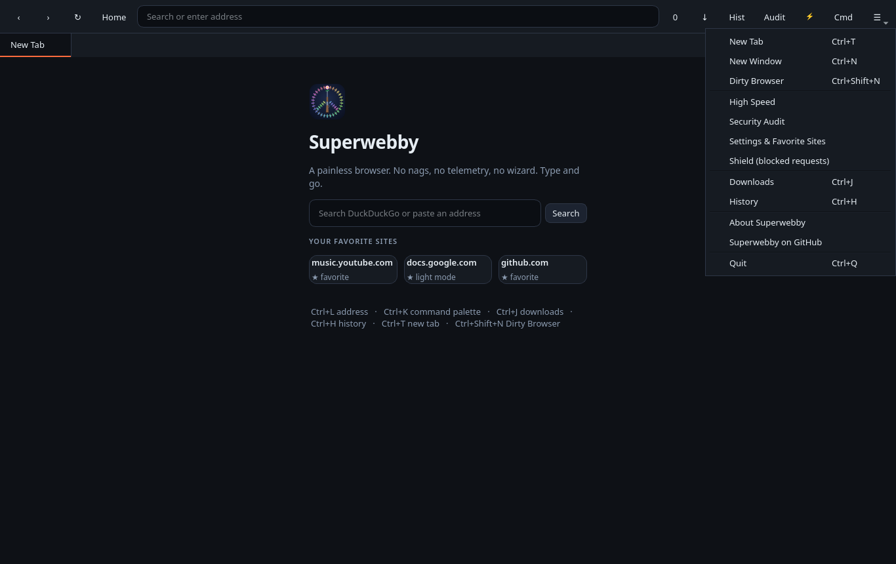
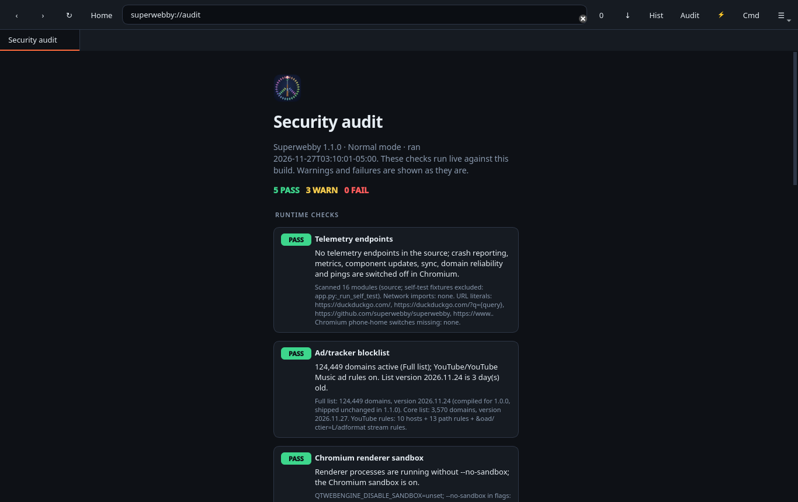
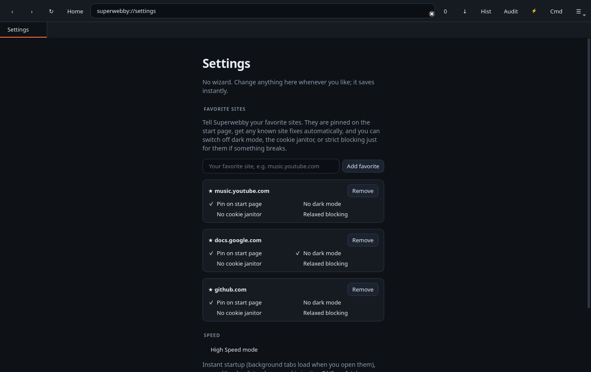

<p align="center">
  
</p>

<h1 align="center">Superwebby</h1>

<p align="center">
  <b>A painless, privacy-first desktop web browser.</b><br>
  Ctrl+J downloads shelf · YouTube &amp; YouTube Music ad blocking · Dirty Browser private windows · High Speed mode · live security audit<br>
  <b>GitHub:</b> <a href="https://github.com/superwebby/superwebby">https://github.com/superwebby/superwebby</a> ·
  <a href="https://github.com/superwebby/superwebby/releases/latest">Latest release</a> ·
  <a href="AUDIT.md">Security audit</a>
</p>

## Install in one line

Superwebby runs on **Linux, Windows 10/11 (x64), and macOS 14 Sonoma or newer
(Apple Silicon and Intel)**. Every build is made by GitHub Actions from this
repository and smoke-tested headlessly before it is attached to the release.

### Windows

1. Download **`superwebby-1.2.0-windows-x64-setup.exe`** from the
   [latest release](https://github.com/superwebby/superwebby/releases/latest)
   and run it. It installs for your user only (no admin prompt) into
   `%LOCALAPPDATA%\Programs\Superwebby` and adds Start-menu entries for
   Superwebby, Dirty Browser, and High Speed.
2. **SmartScreen warning:** the installer is not signed with a paid code-signing
   certificate, so Windows shows *"Windows protected your PC"*. Click
   **More info**, then **Run anyway**.

No installer wanted? Download **`superwebby-1.2.0-windows-x64-portable.zip`**,
extract it anywhere, and run `superwebby\superwebby.exe`.

PowerShell one-liner:

```powershell
iwr https://github.com/superwebby/superwebby/releases/download/v1.2.0/superwebby-1.2.0-windows-x64-setup.exe -OutFile $env:TEMP\superwebby-setup.exe; & $env:TEMP\superwebby-setup.exe
```

### macOS

1. Download the `.dmg` for your Mac from the
   [latest release](https://github.com/superwebby/superwebby/releases/latest):
   **`superwebby-1.2.0-macos-arm64.dmg`** for Apple Silicon (M1 or newer), or
   **`superwebby-1.2.0-macos-x86_64.dmg`** for Intel Macs.
2. Open the `.dmg` and drag **Superwebby** onto **Applications**.
3. **Gatekeeper warning:** the app is only ad-hoc signed (no paid Apple
   Developer ID, not notarized), so the first launch says it can't be checked
   for malicious software. Either **right-click (Control-click) Superwebby in
   Applications → Open → Open**, or, on macOS 15 and newer where that button
   may be missing, open *System Settings → Privacy & Security* and click
   **Open Anyway**. Or clear the quarantine flag in Terminal:

   ```bash
   xattr -dr com.apple.quarantine /Applications/Superwebby.app
   ```

Terminal one-liner (Apple Silicon; use `x86_64` in the file name on Intel):

```bash
curl -LO https://github.com/superwebby/superwebby/releases/download/v1.2.0/superwebby-1.2.0-macos-arm64.dmg && hdiutil attach -nobrowse superwebby-1.2.0-macos-arm64.dmg && cp -R "/Volumes/Superwebby 1.2.0/Superwebby.app" /Applications/ && hdiutil detach "/Volumes/Superwebby 1.2.0" && xattr -dr com.apple.quarantine /Applications/Superwebby.app && open /Applications/Superwebby.app
```

### Linux

**Flatpak (any distro):**

```bash
curl -LO https://github.com/superwebby/superwebby/releases/download/v1.2.0/superwebby-1.2.0.flatpak && flatpak install --user -y ./superwebby-1.2.0.flatpak && flatpak run io.github.superwebby.Superwebby
```

(Needs the Flathub remote for the KDE 6.11 runtime: `flatpak remote-add --if-not-exists --user flathub https://dl.flathub.org/repo/flathub.flatpakrepo`.)

**Arch Linux, prebuilt binary (`superwebby-bin`):**

```bash
mkdir -p superwebby-bin && cd superwebby-bin && curl -L --remote-name-all https://raw.githubusercontent.com/superwebby/superwebby/main/aur/superwebby-bin/{PKGBUILD,superwebby.desktop,LICENSE} && makepkg -si
```

**Arch Linux, from source (`superwebby`):**

```bash
git clone https://github.com/superwebby/superwebby.git && cd superwebby/aur/superwebby && makepkg -si
```

All release files and their SHA256SUMS: <https://github.com/superwebby/superwebby/releases/tag/v1.2.0>

## Screenshots

| Main menu: Dirty Browser and High Speed | Security audit | Favorite sites |
| --- | --- | --- |
|  |  |  |

## About

Superwebby is a new browser — not a repackaged Ladybird, qutebrowser, or surf
build — with a real **Ctrl+J downloads panel** the way Brave used to work,
then pushed further so everyday browsing stays out of your way.

Superwebby uses **Python 3 + PyQt6 / Qt WebEngine** so it actually builds and
renders modern pages, then wraps its own chrome, shortcuts, blocking, and
internal pages around that engine.

The logo is a flower growing out of a rifle's barrel, standing in for the
centre stroke of a giant peace sign made of people holding hands. It is a
peace / anti-violence image ("flower power"), not a weapons one.

## New in 1.2.0

- **Windows and macOS builds.** A Windows x64 installer and portable zip, and
  macOS `.dmg`s for Apple Silicon and Intel, built and smoke-tested by GitHub
  Actions on every release tag (`.github/workflows/release.yml`).
- Profile, settings, and cache use each platform's normal folders (see
  *Where your data lives*). Downloads go to your system Downloads folder.
- The security audit's sandbox check now inspects renderer processes on
  Windows and macOS too, and the about page shows which platform build you run.

## New in 1.1.0

- **Favorite sites.** Add them in `superwebby://settings` (a quiet field, no
  wizard) or with `superwebby --add-favorite music.youtube.com`. Favorites are
  pinned on the start page, pick up built-in site fixes automatically, and each
  one has switches for *no dark mode*, *no cookie janitor*, and *relaxed
  blocking* (core list only and third-party cookies allowed, for logins and
  players). Builds can be personalized with `packaging/bake-favorites.py`.
- **Security audit panel.** `superwebby://audit`, the **Audit** toolbar button,
  or *Menu → Security Audit*. Live checks against the running build: telemetry
  endpoints, blocklist size and version, Chromium sandbox, HTTPS upgrade,
  third-party cookies, WebRTC IP leak, fingerprinting, and the Qt WebEngine /
  Chromium patch level with CVE age, plus build-time bandit and pip-audit
  results. Warnings and failures are shown as they are. See [AUDIT.md](AUDIT.md).
- **YouTube and YouTube Music ad blocking in every build** (Flatpak, AUR source,
  AUR binary): network rules for ad endpoints (`doubleclick`, `/pagead/`,
  `/api/stats/ads`, `/ptracking`, `youtubei/v1/player/ad_break`, and ad streams
  on `googlevideo.com` marked `&oad=`, `ctier=L`, or `adformat`) plus an injected
  script that strips `adPlacements` / `playerAds` from player responses, hides
  ad slots, and skips anything that still plays. Always on, even in High Speed mode.
- **Dirty Browser.** *Menu → Dirty Browser* (also in the Ctrl+K palette and
  Ctrl+Shift+N) opens a private, off-the-record window.
- **High Speed mode.** *Menu → High Speed*, the ⚡ toolbar button, or
  `superwebby --high-speed`: instant startup (background tabs load when you
  open them), the core ad/tracker list only (~3.6k domains instead of ~124k),
  no cookie janitor, DNS prefetch on. YouTube ad blocking stays on.
- **New logo** and a GitHub link on `superwebby://about`.

## Why it exists

Brave used to open downloads with Ctrl+J. When that went away, a small, useful
habit went with it. Superwebby puts the downloads panel back, then removes the
rest of the usual browser friction:

- No telemetry, crash-phone-home, or metrics
- No sign-in nags, no default-browser nag, no first-run wizard
- Built-in ad and tracker blocking from the first request
- Quiet automatic downloads into `~/Downloads`
- Auto dark mode for both chrome and page content
- Cookie-banner auto-dismiss (prefers “Reject all” / “Necessary only”)
- A command palette that searches tabs, history, and commands
- Session restore without asking

## Features

- Tabbed browsing with favicons, drag-reorder, and a closed-tab stack
- Omnibox: URLs, search (DuckDuckGo), and history completion
- Request-interception blocker with a bundled domain list (~124k hosts) plus
  conservative path rules for `/pagead/`, `/ads/pixel`, and similar
- Shield badge shows how many requests were blocked on the current page
- Downloads shelf (Ctrl+J) and a `superwebby://downloads` page
- History panel (Ctrl+H) and a `superwebby://history` page
- Command palette (Ctrl+K)
- Auto dark mode (`ForceDarkMode` + Chromium force-dark)
- Cookie-banner janitor for common CMPs (OneTrust, Cookiebot, Quantcast,
  Didomi, Funding Choices, CookieYes, Osano, and others)
- Permission popups are denied quietly (clipboard paste is still allowed)
- Third-party cookies are refused by a cookie-store filter (plus Chromium's phase-out flag)
- Dirty Browser private windows (menu, Ctrl+Shift+N, or `--incognito`) write nothing to disk
- Internal pages: `superwebby://newtab`, `history`, `downloads`, `about`, `shield`, `audit`, `settings`

Blocking uses a compiled, offline list derived from Peter Lowe’s ad server
list, StevenBlack/hosts (MIT), and EasyList / EasyPrivacy ad- and tracking-
server domains (CC BY-SA 3.0). See `superwebby/data/NOTICE`. The list is
shipped in the source tree so startup never needs a network fetch.

## Keyboard shortcuts

| Shortcut | Action |
| --- | --- |
| Ctrl+T | New tab |
| Ctrl+W | Close tab |
| Ctrl+Shift+T | Reopen last closed tab |
| Ctrl+Tab / Ctrl+PageDown | Next tab |
| Ctrl+Shift+Tab / Ctrl+PageUp | Previous tab |
| Ctrl+1 … Ctrl+8, Ctrl+9 | Jump to tab / last tab |
| Ctrl+L, Alt+D, F6 | Focus address bar |
| Ctrl+Enter (in address bar) | Wrap a bare word as `www.*.com` |
| Ctrl+K | Command palette |
| Ctrl+J | Toggle downloads panel |
| Ctrl+H | Toggle history panel |
| Ctrl+R / F5 | Reload (or stop while loading) |
| Ctrl+Shift+R / Shift+F5 | Hard reload |
| Ctrl+F, F3, Ctrl+G | Find in page / find next |
| Ctrl+Shift+G | Find previous |
| Ctrl+= / Ctrl+- / Ctrl+0 | Zoom in, out, reset |
| Alt+Left / Alt+Right | Back / forward |
| Alt+Home | New tab page |
| Ctrl+N | New window |
| Ctrl+Shift+N | Dirty Browser (private window) |
| F11 | Fullscreen |
| Escape | Close palette, find bar, or panel; stop load |
| Ctrl+Q / Ctrl+Shift+W | Quit window |

## Build it yourself

Flatpak bundle (needs `flatpak` and `flatpak-builder`):

```bash
cd flatpak && ./build-bundle.sh
```

The Flatpak uses `org.kde.Platform` 6.11 and
`com.riverbankcomputing.PyQt.BaseApp` 6.11, which already includes PyQt6 and
Qt WebEngine.

Release tarballs and the stripped PyInstaller binary:

```bash
packaging/run-static-audit.sh        # bandit + pip-audit -> superwebby/data/static_audit.json
packaging/build-source-tarball.sh
packaging/build-bin.sh
```

Windows and macOS (run on that OS; `.github/workflows/release.yml` does this in CI):

```bash
python -m pip install -r packaging/requirements-build.txt
python packaging/pyi_build.py              # dist/superwebby/ (Windows) or dist/Superwebby.app (macOS)
python packaging/ci-smoke.py dist/superwebby/superwebby.exe windows-x64   # headless smoke test
```

The Windows installer is built from `packaging/windows/superwebby.iss` with
Inno Setup 6. Icons (`assets/superwebby.ico`, `assets/superwebby.icns`) are
generated by `packaging/make-platform-icons.py`.

The AUR-style PKGBUILDs live in `aur/superwebby` and `aur/superwebby-bin`.
Until the AUR accepts new accounts again, they are published here rather than
on aur.archlinux.org.

## Running from this tree

```bash
python3 superwebby-run
python3 superwebby-run https://example.com
python3 superwebby-run --incognito          # Dirty Browser
python3 superwebby-run --high-speed
python3 superwebby-run --add-favorite music.youtube.com
python3 superwebby-run --audit               # print the security audit as JSON
python3 superwebby-run --self-test --screenshot /tmp/superwebby.png
python3 superwebby-run --self-test --report result.json   # also write results as JSON (Windows builds have no console)
```

Dependencies: Python 3.11+, PyQt6, PyQt6 WebEngine (Arch: `python-pyqt6`
`python-pyqt6-webengine` `qt6-webengine`; Windows/macOS: `pip install PyQt6 PyQt6-WebEngine`).

### Where your data lives

| | Profile, history, session | Settings | Cache |
| --- | --- | --- | --- |
| Linux | `~/.local/share/superwebby/` | `~/.config/superwebby/` | `~/.cache/superwebby/` |
| Windows | `%LOCALAPPDATA%\Superwebby\` | `%APPDATA%\Superwebby\` | `%LOCALAPPDATA%\Superwebby\Cache\` |
| macOS | `~/Library/Application Support/Superwebby/` | `~/Library/Application Support/Superwebby/config/` | `~/Library/Caches/Superwebby/` |

Under Flatpak, the Linux paths are remapped into the app's sandbox data
directory. Nothing is sent anywhere.

## License

GPL-3.0-or-later. Superwebby uses PyQt6, which is available under the GPL.

## Rendering notes

Qt WebEngine needs a working GL/DRI path to paint web pages. On a normal Arch
desktop that just works. Some virtual framebuffers (Xvfb without DRI3, or
environments with no `/dev/dri`) can leave the web view blank even though the
page loaded, blocking ran, and the rest of the chrome is fine. Superwebby's
own pages (`superwebby://newtab`, history, downloads, about, shield, audit, settings) are native
widgets, so they still appear in that situation. `superwebby --self-test`
checks blocking, the Ctrl+J panel, history, the palette, and writes a
screenshot without requiring a GPU.
